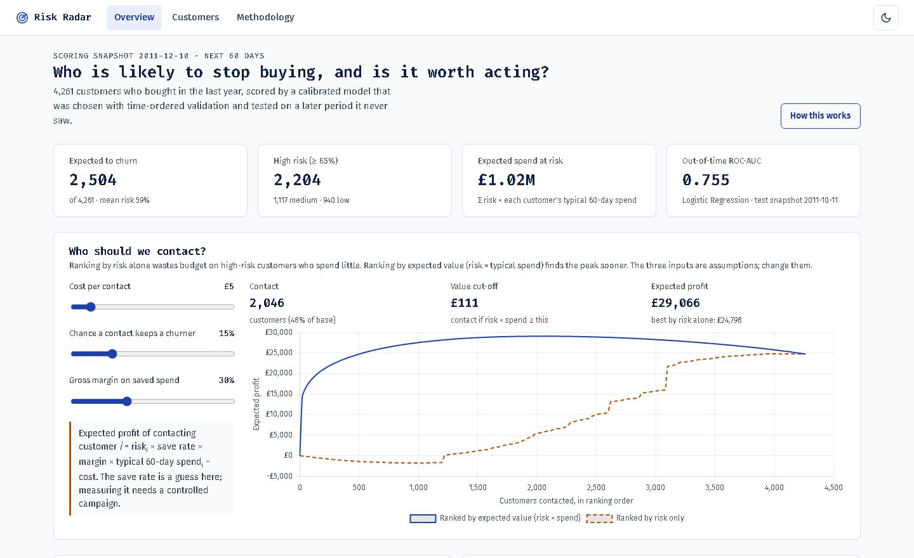
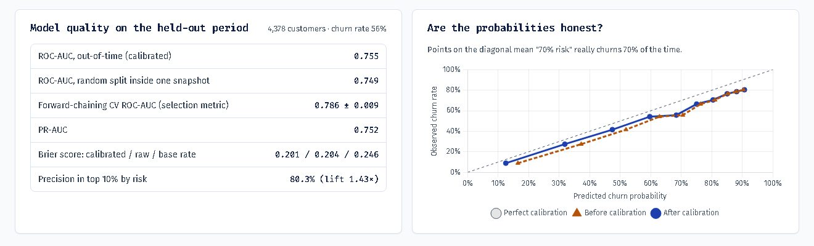
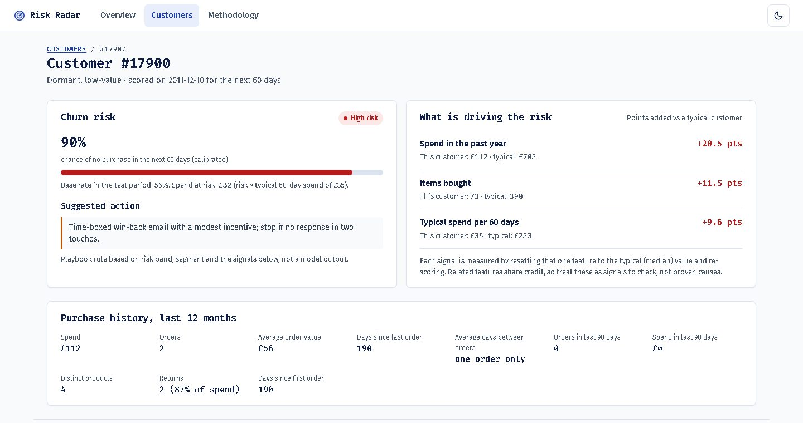

<div align="center">

```
██████╗ ██╗███████╗██╗  ██╗    ██████╗  █████╗ ██████╗  █████╗ ██████╗
██╔══██╗██║██╔════╝██║ ██╔╝    ██╔══██╗██╔══██╗██╔══██╗██╔══██╗██╔══██╗
██████╔╝██║███████╗█████╔╝     ██████╔╝███████║██║  ██║███████║██████╔╝
██╔══██╗██║╚════██║██╔═██╗     ██╔══██╗██╔══██║██║  ██║██╔══██║██╔══██╗
██║  ██║██║███████║██║  ██╗    ██║  ██║██║  ██║██████╔╝██║  ██║██║  ██║
╚═╝  ╚═╝╚═╝╚══════╝╚═╝  ╚═╝    ╚═╝  ╚═╝╚═╝  ╚═╝╚═════╝ ╚═╝  ╚═╝╚═╝  ╚═╝
```

### Customer churn for a UK online retailer: who will stop buying, why, and who is worth contacting

[](https://python.org)
[](https://flask.palletsprojects.com)
[](https://scikit-learn.org)
[](https://xgboost.ai)
[](https://www.chartjs.org)
[](tests/test_pipeline.py)

**Out-of-time ROC-AUC 0.755 · calibrated probabilities · 4,261 customers scored · rank-by-value targeting**



</div>

---

## Table of Contents

- [Overview](#overview)
- [What changed in the November 2026 rebuild](#what-changed-in-the-november-2026-rebuild)
- [Architecture](#architecture)
- [Methodology](#methodology)
- [Results](#results)
- [Customer Segments](#customer-segments)
- [Who to Contact](#who-to-contact)
- [Getting Started](#getting-started)
- [Project Structure](#project-structure)
- [Challenges and Solutions](#challenges-and-solutions)
- [Limitations and Roadmap](#limitations-and-roadmap)
- [Author](#author)

---

## Overview

Risk Radar turns two years of raw transactions (UCI **Online Retail II**, Dec 2009 to Dec 2011, 1,067,371 rows) into:

1. a **calibrated** probability that each active customer makes no purchase in the next 60 days,
2. the **signals** behind each customer's risk,
3. **segments** and a playbook action, and
4. a **targeting curve** that shows how many customers are worth contacting under your cost assumptions.

Every number below is regenerated by `python -m churn_predictor.evaluate`.

### How it differs from a typical churn notebook

| Aspect | Typical student churn project | Risk Radar |
|---|---|---|
| Label | `Recency > N days`, with Recency also a feature (leaks the answer) | Look-ahead window: features before snapshot D, label from [D, D+60 days) |
| Validation | One random split | 13 monthly training snapshots, a later calibration snapshot and a later **out-of-time** test snapshot |
| Model selection | Best test score (selection on the test set) | **Forward-chaining CV** over snapshot dates; the test set is touched once |
| Probabilities | Raw `predict_proba` | Sigmoid or isotonic calibration, chosen inside the calibration period |
| Explanations | Global importance only | Per-customer signals (occlusion), shown with the customer's value vs the typical value |
| Output | A metric | A dashboard plus a cost-based targeting curve |

## What changed in the November 2026 rebuild

| Before | After | Why it matters |
|---|---|---|
| UCI Online Retail (1 year) | **Online Retail II (2 years)** | Enough history for many snapshots and a real out-of-time test |
| One snapshot, random 75/25 split | 13 training snapshots + calibration + out-of-time test | Shows the model works on a later period |
| Model picked by **test** ROC-AUC (the README said CV; the code didn't) | Picked by forward-chaining CV | Removes selection on the test set |
| "Top reasons" sorted raw values with different units, so "Long gap since last order" almost always came first | Occlusion-based signals per customer | Explanations now differ by customer and mean something |
| Fixed 0.35/0.65 bands on uncalibrated scores | Bands on calibrated probabilities | "65% risk" now means about 65% |
| KMeans k=3 on raw skewed values (a 6-customer "Core" cluster) | Log-scaled features, k by silhouette (k=4, 894 to 1,290 customers each) | Usable segments |
| Fixed 0.5 threshold | Expected-profit targeting curve with editable assumptions | Turns a score into a decision |
| `$` signs on a UK retailer | `£` | Correctness |
| No tests | 6 pytest tests (leakage, labels, windows, app end to end) | Confidence the pipeline does what it says |

## Architecture

```
┌──────────────────────────────────────────────────────────────────────────┐
│ DATA   scripts/prepare_data.py: workbook (2 sheets) -> data/online_retail_ii.csv
│        TransactionDataService                                            │
│          clean: duplicates, no customer ID, fees/postage, price <= 0     │
│          snapshot(D): customers active in [D-365d, D), features from < D │
│          label(D):    no purchase in [D, D+60d)                          │
│                                                                          │
│   2010-06 ... 2011-06      2011-08-12       2011-10-11       2011-12-10  │
│   13 TRAIN snapshots  ──►  CALIBRATION  ──►  OUT-OF-TIME ──►  SCORING     │
│   (60-day windows close before the next stage starts)                     │
└───────────────────────────────┬──────────────────────────────────────────┘
                                ▼
┌──────────────────────────────────────────────────────────────────────────┐
│ MODEL  ChurnModelService                                                 │
│   candidates: LogReg | RandomForest | HistGradientBoosting | XGBoost     │
│   selection:  forward-chaining CV over the last 4 training snapshots     │
│   calibrate:  sigmoid vs isotonic, 5-fold log loss inside CAL snapshot   │
│   evaluate:   ROC-AUC, PR-AUC, Brier, log loss, top-decile precision     │
│   explain:    occlusion (reset one feature to median, re-score)          │
│   segment:    KMeans on log RFM, k in 3..6 by silhouette                 │
└───────────────────────────────┬──────────────────────────────────────────┘
                                ▼
┌──────────────────────────────────────────────────────────────────────────┐
│ APP    Flask + Jinja + Chart.js                                          │
│   /              overview: KPIs, targeting curve, quality, calibration   │
│   /customers     search and filter by risk band and segment              │
│   /customers/id  risk, signals, action, purchase history                 │
│   /methodology   every step with the numbers                             │
│   /api/summary   JSON                                                    │
└──────────────────────────────────────────────────────────────────────────┘
```

## Methodology

**Active customer and churn.** At snapshot D, a customer is active if they bought in the 365 days before D. An active customer churned if they made no purchase in the 60 days from D. Features use only transactions strictly before D (a test mutates every future transaction and checks the features don't change).

**Features (38).** Recency and *recency vs own rhythm* (days since last order divided by the customer's average gap between purchase days); orders, spend and products in the last 30/60/90/180 days; order value statistics; tenure; returns; spend trend. Money and count features are log-scaled.

**Model selection.** Forward-chaining CV: each of the last four training snapshots is predicted by a model trained only on snapshots whose label windows had closed. The candidate with the best mean ROC-AUC wins.

**The season experiment.** Customer-grouped CV said adding "season of year" features improved ROC-AUC by about 0.02. On the out-of-time test the selected model got *worse* (0.757 to 0.741): grouped folds mix periods and reward memorising seasons. Under forward CV the gain was 0.0006 (noise), so the features are off by default (`USE_SEASON_FEATURES=1` turns them on).

**Calibration.** Sigmoid and isotonic are compared by 5-fold log loss inside the calibration snapshot (sigmoid 0.504, isotonic 0.508), so sigmoid was used. Isotonic on a few thousand rows produced hard 100% predictions in an earlier run.

## Results



**Model comparison** (forward CV selects; the out-of-time column is reported for transparency only):

| Model | Forward CV ROC-AUC | Customer-grouped CV | Out-of-time ROC-AUC |
|---|---|---|---|
| **Logistic Regression** (selected) | **0.787 ± 0.009** | 0.762 | **0.755** |
| Random Forest | 0.784 | 0.765 | 0.756 |
| XGBoost | 0.777 | 0.765 | 0.749 |
| HistGradientBoosting | 0.773 | 0.760 | 0.748 |

**Out-of-time test** (snapshot 2011-10-11, 4,378 active customers, churn rate 56.0%):

| Metric | Value |
|---|---|
| ROC-AUC (calibrated) | 0.755 |
| ROC-AUC, old protocol (random split inside one snapshot) | 0.749 |
| PR-AUC | 0.752 |
| Brier score: calibrated / raw / always-predict-base-rate | 0.201 / 0.204 / 0.246 |
| Log loss: calibrated / raw | 0.592 / 0.600 |
| Precision in the top 10% by risk | 80.3% (1.43x lift over the base rate) |

The four models land within 0.01 of each other out of time, so the simplest one, which also explains most cleanly, is a good outcome rather than a compromise.

**Most important features** (permutation importance on the test snapshot): days with a purchase, spend in the past year, items bought, typical spend per 60 days, orders in the past year, average order value.

## Customer Segments

KMeans on log-scaled recency, orders, spend and average order value; k from 3 to 6 by silhouette (best k=4, silhouette 0.257). Names come from each cluster's medians.

| Segment | Customers | Mean risk | Median days since order | Median orders | Median spend |
|---|---|---|---|---|---|
| Loyal high-value | 894 | 22% | 15 | 15 | £6,146 |
| Recent, light buyers | 1,030 | 54% | 18 | 4 | £1,045 |
| Slipping high-value | 1,290 | 69% | 100 | 4 | £1,522 |
| Dormant, low-value | 1,047 | 82% | 139 | 2 | £294 |



## Who to Contact

Expected profit of contacting customer *i* = risk × save rate × margin × the customer's typical 60-day spend − cost. Only the risk comes from the model; the other three are assumptions set with sliders.

With £5 per contact, a 15% save rate and a 30% margin:

| Ordering | Customers contacted at the peak | Expected profit at the peak |
|---|---|---|
| By expected value (risk × spend) | 2,046 (48%) | £29,066 |
| By risk alone | 4,010 (94%) | £24,798 |

Ranking by risk alone contacts high-risk customers who spend little first, so profit dips before it rises. Ranking by expected value earns more with half the contacts. The save rate is a guess; measuring it needs a controlled experiment, which is the subject of my next project (uplift modelling for retention).

## Getting Started

```bash
git clone https://github.com/ARFaisal-Rehman/Churn-Predictor.git
cd Churn-Predictor
python -m venv .venv && .venv\Scripts\activate      # macOS/Linux: source .venv/bin/activate
pip install -r requirements.txt

# 1. Data (CC BY 4.0, not committed): download online_retail_II.xlsx from
#    https://archive.ics.uci.edu/dataset/502/online+retail+ii
python scripts/prepare_data.py path/to/online_retail_II.xlsx     # about 1 minute

# 2. Train, calibrate, evaluate (about 2 minutes) and print the README numbers
python -m churn_predictor.evaluate

# 3. Run the app
python app.py        # http://127.0.0.1:5000

# Tests (synthetic data, no download needed)
python -m pytest
```

Settings (environment variables): `CHURN_DATA_PATH`, `PREDICTION_WINDOW_DAYS` (60), `ACTIVE_LOOKBACK_DAYS` (365), `SNAPSHOT_STEP_DAYS` (30), `USE_SEASON_FEATURES` (0), `ALLOW_RETRAIN` (0; enables `POST /api/retrain`).

## Project Structure

```
Churn-Predictor/
├── app.py                         Flask entry point
├── churn_predictor/
│   ├── config.py                  paths and settings
│   ├── routes.py                  pages and JSON endpoints
│   ├── evaluate.py                retrain + print the README numbers
│   └── services/
│       ├── data_service.py        cleaning, snapshots, features, labels
│       ├── model_service.py       selection, calibration, evaluation, explanations, segments
│       └── analysis_service.py    orchestration and cached artifacts
├── scripts/prepare_data.py        xlsx -> csv
├── templates/                     base, dashboard, customers, profile, methodology, error
├── static/css/app.css             design tokens, light and dark themes
├── tests/test_pipeline.py         leakage, labels, windows, end-to-end app
└── docs/                          screenshots
```

## Challenges and Solutions

| Challenge | Solution |
|---|---|
| A random split inside one snapshot hides whether the model works later | Rolling snapshots with an out-of-time test |
| Grouped CV preferred season features that hurt on the later period | Forward-chaining CV for every selection decision |
| The test period (Oct to Dec, pre-Christmas) churned at 56% vs 66% in the calibration period | Reported openly; calibration gain is modest. The fix is calibrating on the same season a year earlier, once more years exist |
| Isotonic calibration produced 100% probabilities | Calibration method chosen by CV inside the calibration snapshot |
| Several invoices on the same day made "days between orders" zero | Rhythm measured between distinct purchase days |
| Explanations that always said the same thing | Occlusion against the training median, with the customer's value and the typical value shown |

## Limitations and Roadmap

- One retailer, mostly wholesale buyers, 2009-2011: results won't transfer to other businesses as they are.
- Risk is not persuadability. Who to contact properly needs uplift modelling and an experiment (next project: Retention Intelligence).
- Occlusion explanations share credit between correlated features; treat them as signals, not causes.
- Roadmap: same-season calibration with more years of data; a monitoring view of score drift between snapshots.

## Author

**Abdul Rehman Faisal** · BS Data Science, GIKI · [GitHub](https://github.com/ARFaisal-Rehman) · [LinkedIn](https://www.linkedin.com/in/abdul-rehman-faisal-2a680b297)
